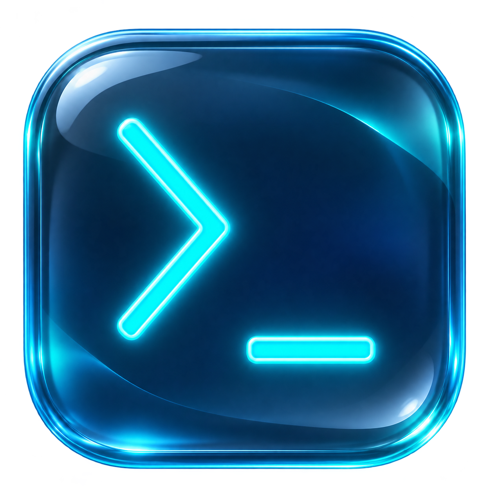

<div align="center">



# DashowBoard

Your stack. One clear view.

A local-first desktop workspace for projects, deployments, services, and incidents.


[Explore the project](https://enzocaetano015.github.io/DashowBoard/) · [Download for Windows](https://github.com/EnzoCaetano015/DashowBoard/releases/latest)

</div>

## About

DashowBoard is an open-source desktop app that brings visibility across GitHub, Vercel, Railway, and Supabase into one workspace.

Group repositories and services, monitor deployments and availability, and follow meaningful incidents. Settings, resource links, and history stay in a local SQLite database. Provider credentials are handled by the native credential vault. The app does not create, administer, or delete external resources.

## Features

- A combined view of projects and monitored services.
- Independent GitHub, Vercel, Railway, and Supabase integrations.
- Availability monitoring and optional URL health checks.
- Local status history, snapshots, and incidents.
- Glass surfaces with light and dark themes, comfortable and compact layouts.
- English interface, accessibility labels, errors, and documentation.
- Tauri 2 desktop runtime with packaged Windows releases.

## Stack

React 19, TypeScript, Vite, Tauri 2, Rust, TanStack Query, React Router, Tailwind CSS, shadcn/ui, and SQLite.

## Quick start

```bash
git clone https://github.com/EnzoCaetano015/DashowBoard.git
cd DashowBoard
pnpm install
pnpm tauri dev
```

For a visual browser preview:

```bash
pnpm dev
```

Native integrations, credential storage, notifications, and the local database require Tauri. The static landing page lives in `site/` and requires no build step.

## Documentation

| Guide | Contents |
|---|---|
| [Architecture](./docs/architecture.md) | Application flow, layers, and source layout. |
| [Domain and monitoring](./docs/domain-and-monitoring.md) | Projects, repositories, services, statuses, and incidents. |
| [Development](./docs/development.md) | Local setup, commands, tests, database, themes, and brand assets. |
| [Integrations and security](./docs/integrations-and-security.md) | Providers, tokens, permissions, and error handling. |
| [Publishing and contributing](./docs/publishing-and-contributing.md) | Landing page, CI, releases, and contribution workflow. |

## Author

Built by **Enzo Caetano**.

[GitHub](https://github.com/EnzoCaetano015) · [Portfolio](https://www.caetanodev.com/) · [LinkedIn](https://www.linkedin.com/in/enzo-caetano-814736290/)
