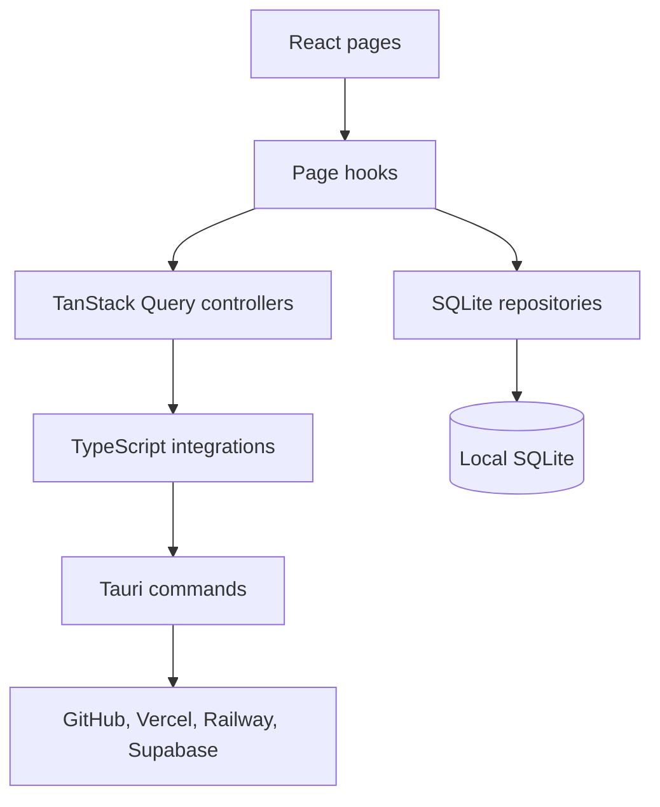

# Architecture

[← Back to README](../README.md)

DashowBoard combines a React interface with native capabilities provided by Tauri. SQLite stores local data, while Rust commands handle secure operating-system access and external API calls.

## Data flow

## Layers

- `src/pages`: screens, page hooks, and page-specific components and dialogs. Each data-driven screen handles loading, error, empty, partial, and success states.
- `src/components`: reusable domain components and shadcn/ui primitives in `ui`. Shared dialogs and query states use the composed `Modal` and `TemplateEstado` APIs.
- `src/backend/api/controllers`: TanStack Query hooks, mutations, cache keys, and refresh policies.
- `src/backend/api/integrations`: the boundary between the frontend and Tauri commands.
- `src/backend/api/models`: external contracts and normalized domain models.
- `src/backend/api/enums`: known providers, statuses, and other domain values.
- `src/backend/sql`: SQLite initialization, incremental migrations, transactions, and repositories. Screens never execute SQL directly.
- `src/lib`: shared configuration, global hooks, utility types, and pure helpers.
- `src-tauri`: native runtime, provider clients, credential storage, URL health checks, system tray, and frontend commands.

## Navigation and state

Routes use `createHashRouter` to work in the packaged desktop app. TanStack Query handles remote state and polling. SQLite persists settings, resource links, observations, and incidents; it is not a temporary query cache.

## Design and compatibility

The app uses theme tokens and shared glass materials for light and dark modes. Large panels transmit ambient canvas colors; nested controls use reflected borders without repeatedly filtering the backdrop. Reduced-motion preferences and opaque fallbacks remain supported.

English presentation labels are independent of existing persisted enum values. Database columns, published migrations, native command names, credential identifiers, and stored snapshots must remain compatible with existing installations.

## Principles

- Keep external API calls, SQL, and Tauri access out of presentation components.
- Isolate provider failures so one unavailable integration does not block the others.
- Persist meaningful state transitions rather than repeating the same incident on every poll.
- Keep native and network permissions minimal.
- Remote resource creation, administration, and deletion are outside the current scope.
